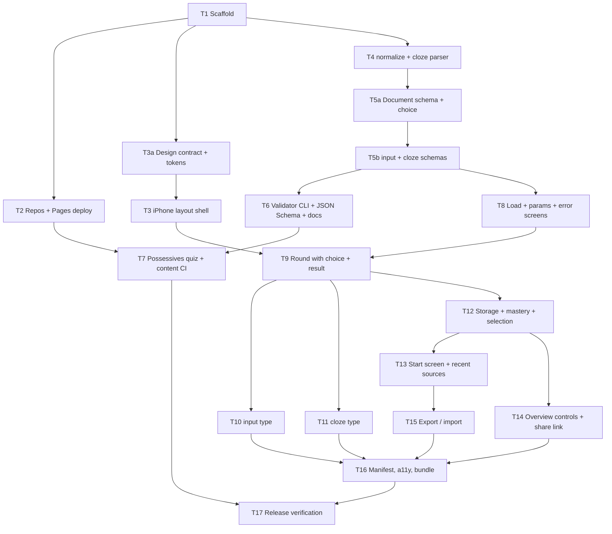

# Implementation Plan: Quiz v1

## Overview
Build the v1 quiz player from [`SPEC.md`](../SPEC.md): a Preact + TypeScript app on GitHub Pages that loads a validated JSON quiz from a link, plays rounds with `choice`/`input`/`cloze` questions, tracks per-question mastery in `localStorage`, and works on iPhone without the keyboard hiding anything. In parallel, the `quiz-content` repo gets the first quiz (possessive determiners) with CI validation. Tasks and acceptance criteria live in [`todo.md`](todo.md).

## Architecture Decisions
- **Risk first.** The two things most likely to force a redesign are proven before features are built: Pages deployment of both repos (T2) and the iPhone keyboard layout (T3). The T3 layout shell becomes the real round layout, not throwaway code. T3 also decides how focus survives between typed questions, which fixes the question-type UI contract before T9.
- **Design system before screens.** T3a writes `docs/design.md` (screen jobs, states, responsive rules, rejected patterns) and semantic tokens for light and dark mode. Every UI task uses tokens only; dark mode and contrast are never retrofitted.
- **Quality built per task, not at the end.** Every UI task implements its screen states (loading, empty, error, all-mastered, perfect round, storage unavailable), has a keyboard-only component test with axe, and is checked in light and dark mode. T16 is a final sweep only.
- **URL is the overview state.** Category and round size live in the hash (`replaceState`), so sharing is `location.href`; a round is one history entry so swipe-back returns to the Overview.
- **Round owns the shell, types own the content.** The Round screen owns action bar, scoring, and focus; question components implement `QuestionProps` (SPEC "Code Style") and never render the primary button.
- **Split question-type definitions into a non-JSX part and a UI part.** `question-types/definitions.ts` lists schema + `check` per type (no Preact imports) and is what `format/` and the CLI use; `question-types/registry.tsx` dispatches to the components for the app. The Node CLI never loads JSX.
- **The generated JSON Schema covers structure only.** Cross-field rules (category references, unique ids, answer ∈ options, cloze gaps) live in Zod refinements and are enforced by the app and the CLI, not by editor autocompletion.
- **Contract before UI.** The format (T5a, T5b) and the validator (T6) are finished before any question UI, so content authoring (T7) runs in parallel with the app work.
- **Vertical slices for play.** Load → overview → round → result works first with `choice` only (T8, T9); `input` and `cloze` are added as one slice each (T10, T11), each verified in the iOS Simulator.
- **Progress after play.** Storage and mastery (T12) plug into a working round; the entry-point features (start screen, sharing, export) build on top.
- Repos: `framegrabber/quiz` (app), `framegrabber/quiz-content` (quizzes). Both public, Pages source "GitHub Actions". Creating them is an outward action: done via `gh` only after your confirmation in T2.

## Dependency Graph

## Task List

### Phase 1: Foundation and risk spikes
- [x] T1: Scaffold the app project
- [x] T2: Create repos and Pages deployment
- [x] T3a: Design contract and tokens (light + dark)
- [x] T3: iPhone round layout shell (visual viewport + keyboard, focus mechanism)
- [x] T4: Answer normalization and cloze parser

### Checkpoint A: Foundation
- [x] `npm run typecheck && npm test && npm run build` pass
- [x] `https://framegrabber.github.io/quiz/` serves the app; a JSON file from `quiz-content` loads from the app origin
- [x] Layout shell verified in the iOS Simulator (iPhone SE 3rd gen and iPad, keyboard open); focus mechanism decided: (b), see `docs/design.md`
- [x] Design tokens reviewed by you in light and dark mode
- [x] Review with you

### Phase 2: Format contract
- [x] T5a: Format document schema with `choice`
- [x] T5b: `input` and `cloze` schemas and checks
- [x] T6: Validator CLI, generated JSON Schema, authoring docs
- [x] T7: Possessive determiners quiz and `quiz-content` CI (parallel with Phase 3)

### Checkpoint B: Contract
- [x] Possessives quiz validates locally and in `quiz-content` CI; an invalid copy fails CI
- [x] `docs/quiz-format.md` reviewed by you (it is the contract for AI authoring)

### Phase 3: Playable slices
- [x] T8: Loading, hash params, error screens
- [x] T9: Round with `choice` and result screen
- [x] T10: `input` question type
- [x] T11: `cloze` question type

### Checkpoint C: Playable
- [x] The possessives quiz is fully playable from a `#src=` link
- [x] Each type verified in the iOS Simulator on iPhone SE and iPad (keyboard open/closed, light and dark)
- [x] Review with you

### Phase 4: Progress and entry points
- [ ] T12: Storage, mastery, and round selection
- [ ] T13: Start screen with recent sources
- [ ] T14: Overview controls and share link
- [ ] T15: Progress export and import

### Checkpoint D: Feature complete
- [ ] Success criteria 2, 5–9, 17, 18 of the spec demonstrably met
- [ ] Review with you

### Phase 5: Release
- [ ] T16: Home-screen manifest, final accessibility and responsive sweep, bundle budget
- [ ] T17: Release verification on simulator, real iPhone, and Pages

### Checkpoint E: Complete
- [ ] All 18 spec success criteria met
- [ ] Ready to share with the class

## Parallelization
- T2, T3a, and T4 after T1 (T3 after T3a); T7 (content) alongside Phase 3; T10 and T11 after T9 (separate folders, shared only via the registry line); T13 and T14 after T12 (different screens). T15 waits for T13 (same Start screen).
- Everything else is sequential.

## Risks and Mitigations
| Risk | Impact | Mitigation |
|---|---|---|
| iOS keyboard handling (`visualViewport`, focus retention) behaves differently than expected on iOS 26 Safari | High | T3 proves it in the Simulator before any question UI exists; fallback for continuing typed questions: accept a keyboard close/reopen but keep the layout guarantee |
| Neither focus mechanism keeps the keyboard open on iOS | Med | Detected in T3, before the contract is fixed; then the spec's keep-open requirement is relaxed with your OK, layout guarantees stay |
| Dark-mode colors fail contrast on real screens | Low | Ratios computed in T3a and listed in `docs/design.md`; re-checked in T16 |
| Simulator keyboard differs from a real device (QuickType bar height, iOS 26 floating toolbar) | Med | Real iPhone smoke in T17; layout uses the measured visual viewport, not fixed keyboard heights |
| Zod 4 refinements are invisible in the generated JSON Schema | Low | Documented; the CLI is the authority, the schema only drives autocompletion |
| Node native TS stripping can't load a module the CLI imports (JSX, non-erasable syntax) | Med | `erasableSyntaxOnly` + `definitions.ts` without Preact; CLI run is part of T6 acceptance |
| Preact 11 ecosystem gaps (`@testing-library/preact` peer is `preact >=10`, so allowed) | Low | Confirmed in T1 by running one component test; fallback Preact 10 needs your OK |
| 60 KB gzip budget exceeded by Zod 4 | Med | Measured in T5a: Preact + format module = 31.3 KB gzip (German locale imported alone). Leaves ~29 KB for UI; switch to `zod/mini` only if T16 exceeds the budget |
| AI-written content has language errors | Med | You review the quiz in T7 before publishing |

## Human Steps
- T2: confirm creating the two public repos and enabling Pages.
- T3a: review the design tokens (light + dark).
- T7: review the quiz content.
- T17: run the real-iPhone check (or hand me observations).

## Open Questions
- None blocking. Repo creation waits for your confirmation in T2.
